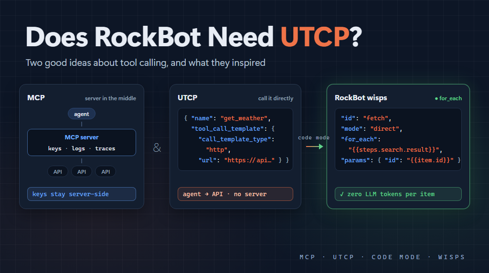

One of the things I enjoy most about the agent tooling space right now is how many people are trying new ideas. The [Model Context Protocol](https://modelcontextprotocol.io) (MCP) has become the default way to connect agents to tools, but it's far from the only idea out there. One project that has caught my attention is the [Universal Tool Calling Protocol](https://www.utcp.io) (UTCP).

I build and run several things that live in this space: [RockBot](https://rockbot.dev) (my agent framework and agent), an MCP aggregator, and [AgentRegistry](https://github.com/MarimerLLC/agentregistry) (a registry where agents and tool servers can find each other). So I took a serious look at whether UTCP belongs in any of them.

The short answer for my projects: not right now. But working through UTCP's ideas did inspire an improvement to RockBot, and I came away with a lot of respect for what the UTCP team is doing.

## What UTCP is

UTCP starts from a smart observation. Many tools an agent wants to use already have perfectly good interfaces: REST APIs, command line tools, WebSockets, gRPC services. MCP asks you to put a server in front of each one so the agent can talk MCP to it. UTCP asks: why not just describe the existing interface and let the agent call it directly?

So instead of a server, a UTCP provider publishes a *manual*. The manual is a JSON document that lists tools, each with:

- a name and description
- input and output JSON schemas
- a *call template* that says how to call the tool over its own interface: HTTP, server-sent events, streamable HTTP, CLI, WebSocket, a text file, or even MCP

The agent reads the manual and then calls the tool directly. A provider can serve its manual at a well-known `/utcp` endpoint. A UTCP client can also point at an existing OpenAPI document and convert it into a manual automatically, which is a really nice touch, because it means a huge number of existing APIs are usable right away.

Credentials (API keys, basic auth, OAuth2 client credentials) appear in the manual as `${VARIABLE}` references. The client fills them in from its own configuration.

The [project](https://github.com/universal-tool-calling-protocol) has actively maintained SDKs for Python, TypeScript and Go. It also has an MCP bridge in both directions, so it works alongside MCP rather than against it, and a "code mode" library that I'll come back to. The core spec is still a draft RFC, so it's a young project that's still evolving.

## How it compares to MCP

UTCP's own comparison frames it as "direct" versus MCP's "middleman" model. I think the more useful way to see it is that the two make different trade-offs, and each fits different situations.

**Where UTCP shines:**

- No wrapper server to build, deploy and keep running for every API you want to expose.
- No extra network hop.
- You can describe an API you don't own, as long as it has a usable interface (or an OpenAPI document).
- It's simple. Writing a manual is much less work than writing a server.

**What MCP offers that UTCP doesn't aim to:**

- **More than tool calls.** MCP has prompts, resources, elicitation (the server asking the user a question mid-call), sampling, tasks and notifications. UTCP deliberately focuses on calling tools. My own MCP servers use prompts, OAuth sign-in and mid-call questions, so I need those features.
- **A server-side place for secrets.** With UTCP, the client holds the credentials, and the manual says where they're sent. That's part of what makes it simple, and it also means you need to trust the manuals you load. The UTCP RFC is upfront about this and recommends loading only trusted manuals.
- **A large ecosystem.** MCP has a big head start in servers and client support.

**The middleman has value.** UTCP's design removes the server in the middle, and for many scenarios that's a real win. For my scenarios, though, I find the server in the middle worth keeping. It reminds me of an old lesson from n-tier architecture. Back when client/server apps talked straight to the database, every client machine needed a connection string, and often the credentials to go with it. Moving to n-tier, with an application server between the clients and the database, meant the keys to the database lived only on the app server. No client ever saw them, and the whole system was more secure as a result. An MCP server (or an aggregator in front of several) plays the same role for agents. The agent holds a credential for the MCP server, not the keys to every API behind it. A central server is also the natural place for logging and tracing. Every tool call passes through one spot, so you can record who called what, with which arguments and what result, and connect it all with distributed tracing. When agents call tools directly, that record is spread across every client and every API.

**Both protocols keep improving.** One thing UTCP's early comparisons pointed out was that MCP was heavy and stateful. The [2026-07-28 MCP specification](https://blog.modelcontextprotocol.io/posts/2026-07-28-release-candidate/) made the protocol stateless: no sessions, no initialization handshake, each request stands on its own, and any request can land on any server instance behind a plain load balancer. I think having projects like UTCP asking "does it have to be this complicated?" is healthy pressure for the whole ecosystem.

## RockBot

RockBot's tool system isn't tied to MCP. At the core there's a tool registry: each tool is a name, a description, a JSON schema and an executor. MCP servers, A2A agents, web tools, scripts and wisps all register into it. Adding a UTCP tool source would be easy at the basic level.

I've decided not to, for reasons that are about RockBot more than about UTCP.

**RockBot already has its own answer for large tool sets.** Some of the motivation for UTCP is handling lots of tools: too many for a model to choose from, and too much context spent describing them. Over the past year I've built a lot of RockBot machinery for that problem:

- the model searches for tools and activates them per session
- each tool gets its own typed definition, not a generic "call some tool" shim
- markdown guides for each subsystem
- caps that keep each request under the provider's tool limit

UTCP has its own pluggable tool search, but bringing UTCP tools into RockBot's existing machinery would be a fair amount of work for tools I can already reach another way.

**Security model.** RockBot follows a "nothing trusts the LLM" design, and the model can manage some of its own server connections. Since a UTCP manual says where credentials are sent, I'd need to keep the model away from adding manuals, which takes away much of the convenience.

**I tried something similar.** RockBot once had a REST API gateway, which was a similar idea, and I ended up removing it in favor of putting everything behind MCP. That experience shapes my thinking here.

## The MCP aggregator

The aggregator is where UTCP's ideas fit best for me. Its job is to sit in front of many backend servers and present them as one MCP server, with tool search, typed wrapper tools and skills. A UTCP or OpenAPI backend would fit there nicely: read the manual (or OpenAPI document), present those tools as MCP tools, and make the calls from the server side.

That combines the best of both. UTCP's manual format makes it easy to describe existing APIs, and the server in the middle keeps credentials on the server and logs and traces every call in one place. Every MCP client gets the tools without knowing UTCP is involved.

If I do this, I'll probably start with OpenAPI import, since that's where most of the APIs I'd want to expose are described today, and add UTCP manuals alongside it. I'd also stick to HTTP-style call templates, registered by an operator. I'll build it when I have a specific REST API I want to expose.

## AgentRegistry

This is the most natural fit of the three. AgentRegistry is deliberately protocol agnostic. It already lists A2A agents, MCP servers and ACP agents. It stores each one's native description as metadata, and it doesn't speak any of those protocols itself. Adding UTCP would mean one more protocol type and a small adapter, about the size of the ACP one.

There's also a fun twist: the registry already publishes an OpenAPI document, and UTCP clients can convert OpenAPI on the fly. So a UTCP client should be able to use the registry's discovery API today, with no changes at all. That's a nice demonstration of UTCP's "use what's already there" approach.

If I add UTCP support, I'd follow the UTCP RFC's own trust guidance: require HTTPS and an admin key to register a manual, and leave out CLI templates, since discovery in the registry is public.

The main reason I haven't done it yet is simply demand. Right now nothing in my own world publishes or consumes UTCP manuals. As the UTCP ecosystem grows, this is the first place I'd add it.

## Inspired by code mode

The most interesting thing I found in the UTCP project is [code mode](https://github.com/universal-tool-calling-protocol/code-mode). Instead of the model making one tool call at a time, with a full round trip through the LLM for each, the model writes a short script that calls tools as ordinary functions. The script runs in a sandbox, and only the final result goes back into the model's context. It's a clever idea, and the UTCP team made it work over MCP tools as well as UTCP ones.

It addresses the same problem as RockBot's *wisps*, from a different angle.

A wisp is a lightweight pipeline the agent can spawn for a multi-step task when it knows the steps in advance. Steps either call a tool directly (no LLM involved at all), or hand a tightly-scoped prompt to a small, cheap model. A five-step task that might cost 60-80K tokens as a subagent costs about 2-12K as a wisp.

Comparing the two was useful, because each does something the other doesn't.

**What wisps bring.** The harness runs a wisp's steps, rather than code the model wrote, which fits RockBot's "nothing trusts the LLM" principle. Because a wisp is *data*, RockBot can:

- validate it before running anything
- limit which tools it can touch
- recognize when the model retries the same wisp, and learn from failures over time
- notice when a tool it depends on has changed

**What code mode brings: control flow that depends on the data.** A wisp is a straight list of steps. It can pass results from one step to the next and skip ahead on failure, but it can't loop or make decisions. Take "search my email, then fetch each of the N messages that came back". In code mode that's a simple `for` loop. In a wisp, today, it needs a step handled by the small model, so tokens are back on the meter for purely mechanical work.

Code mode made that gap obvious to me, and it inspired a fix that fits how wisps already work. I've opened an issue to add a [`for_each` step to wisps](https://github.com/MarimerLLC/rockbot/issues/779). A direct step names a list from a previous step's result, and the harness runs it once per item, with limits on item count and concurrency and per-item failure handling. A simple `when` condition may follow. Both stay declarative, so wisps keep everything that comes from being data, and gain much of what makes code mode so appealing.

## Where I landed

| | Can it use UTCP? | Should it, today? |
|---|---|---|
| RockBot | Yes, easily | Not for now. Its existing tool machinery already covers my needs |
| MCP aggregator | Yes, as a gateway | Likely, starting with OpenAPI import, when there's a real API to expose |
| AgentRegistry | Yes, most naturally | Yes, once UTCP manuals show up in my world |
| Code mode | Partly covered by wisps | Inspired a `for_each` (and maybe `when`) step for wisps |

UTCP makes a great point: wrapping every existing API in a server just so an agent can call it is a lot of ceremony. For my own projects I prefer to keep a trusted server in the middle, so the place I'd use UTCP's ideas is inside the aggregator rather than in every agent. And code mode gave me a concrete improvement to RockBot that I wouldn't have thought of otherwise.

Thank you to the UTCP team for pushing on these ideas and sharing them openly. If you build agents, I encourage you to [take a look at UTCP](https://www.utcp.io) and its code mode library. Even if you stick with MCP, as I am, it's well worth seeing a different take on the problem. I'll be following the project as it matures.

_This post was authored with the assistance of AI._
