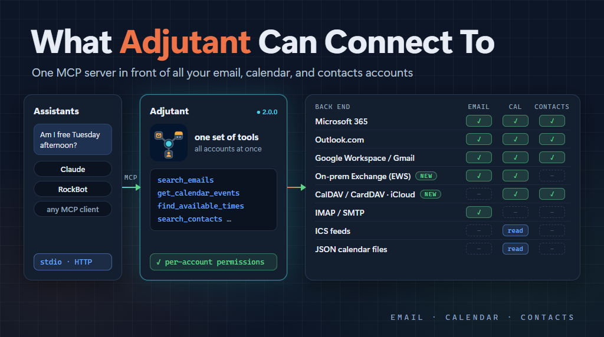

We just shipped Adjutant 2.0.0. The biggest change is the name, but the last few releases also added two new back ends: CalDAV and CardDAV, which means (among other things) iCloud calendars and contacts, and on-premises Exchange. That seemed like a good excuse to step back and write down everything Adjutant can talk to at this point, because the list has grown quite a bit since I last wrote about it.

If the name doesn't ring a bell, that's because it used to be called calendar-mcp. When I wrote about it in [The RockBot Band](/2026/03/03/The-RockBot-Band) back in March, I described it as an MCP server that provides access to "multiple M365, outlook.com, and Gmail email and calendar accounts." That was true then. It is _quite_ a bit more than that now.

Why the new name? The project started as a way to get calendar info, so calendar-mcp made sense at the time. But then it expanded to email, contacts, and more calendar features. Basically everything you would expect from a personal adjutant. So that's what it is called now, and the GitHub repo has moved to [MarimerLLC/adjutant](https://github.com/MarimerLLC/adjutant) to match.

## The idea

The core idea hasn't changed. Most of us don't have _one_ email account and _one_ calendar. I have work, personal, family, and client accounts spread across several providers, and an AI assistant that can only see one of them doesn't really know what my day looks like.

Adjutant sits in front of all those accounts and exposes one set of MCP tools: get and search email, send email, list calendars, get events, find free time, create and update events, respond to invites, and read and manage contacts. The assistant asks "am I free Tuesday afternoon?" and Adjutant checks _every_ calendar, not just the one that happened to be easiest to wire up.

What _has_ changed is the list of places those accounts can live.

## The current list

Here's the summary, then I'll go through each one.

| Back end | Email | Calendar | Contacts | Auth |
|---|:---:|:---:|:---:|---|
| Microsoft 365 | Yes | Yes | Yes | OAuth (MSAL) |
| Outlook.com | Yes | Yes | Yes | OAuth (MSAL) |
| Google Workspace / Gmail | Yes | Yes | Yes | OAuth |
| IMAP/SMTP | Yes | - | - | Username + app password |
| On-premises Exchange (EWS) | Yes | Yes | - | Username + password |
| CalDAV / CardDAV | - | Yes | Yes | Username + app password |
| ICS feeds | - | Read-only | - | None |
| JSON calendar files | - | Read-only | - | None, or an existing Microsoft account for OneDrive |

### Microsoft 365 and Outlook.com

These are the originals, along with Google. Both use the Microsoft Graph API with MSAL for authentication, and both support full read/write for email, calendar, and contacts.

M365 is the more interesting of the two, because you can connect accounts from multiple tenants at once. You can use one multi-tenant app registration across all of them, or a separate app registration per tenant when a tenant's IT policies won't let an outside app in. Every account gets its own token cache, so there is no chance of one tenant's tokens leaking into another.

Outlook.com is the same idea for personal Microsoft accounts.

### Google Workspace and Gmail

Also an original. Gmail, Google Calendar, and Google Contacts (via the People API), with full read/write. Like M365, you can use one OAuth client for everything or a separate one per Workspace organization if an admin restricts outside apps.

### ICS feeds

This was the first addition, back in February, and it came from a very practical problem. Sometimes you just _can't_ get permission to use the normal APIs. My own work calendar was in this category.

But a lot of calendar systems can publish an ICS feed at a URL. So Adjutant can read those. It handles recurring events, free/busy blocks, and pulls online meeting links out of events, with in-memory caching so it isn't hammering the feed.

It is read-only, of course. You can see the calendar, but the assistant can't create events on it.

### JSON calendar files

Same problem, different workaround, added the same day as ICS.

If you are on M365 and have Power Automate, you can create a flow that runs periodically and exports your calendar to a JSON file on your personal OneDrive. Adjutant can read that file, either from a local path (so it works with whatever sync tool you use) or straight from OneDrive via the Graph API. For the OneDrive option it can reuse the credentials of an Outlook.com or M365 account you've already connected, so there's no extra login.

Is this a bit of a hack? Sure. But it gets your work calendar into the picture when nothing else will, and the data is only as stale as however often the flow runs.

Also read-only.

### IMAP/SMTP

This one came along in April, and it was driven by [RockBot](https://rockbot.dev).

RockBot has its own Gmail mailbox, and the normal Google OAuth path just doesn't work for it. When a consumer Gmail account authenticates against an OAuth app that is still in "Testing" status (which is the only realistic status for a self-hosted server asking for Gmail scopes), Google revokes the refresh token after 7 days. That's fine for a human, who can just log in again. For an unattended bot it is a dead end.

So Adjutant now has an IMAP/SMTP provider. With a Gmail app password there's no OAuth at all, and the credentials work until you revoke them.

The defaults are tuned for Gmail, but every host, port, and folder name can be overridden, so it works with Fastmail, iCloud Mail, Yahoo, or a server you run yourself. It is email-only, but full read/write: read, search, send, delete, move, mark read.

The password is encrypted at rest using ASP.NET DataProtection. That matters more now that there are two providers storing passwords instead of OAuth tokens.

### CalDAV and CardDAV

This one arrived in 1.9.0, in October.

CalDAV and CardDAV are the open standards for calendars and contacts, and they are how you get to iCloud. Apple doesn't offer OAuth for third-party CalDAV access, only app-specific passwords over HTTPS. So this provider uses the same encrypted password storage as IMAP.

This provider came from a community contribution by [KifoPL](https://github.com/KifoPL), who wrote up a really thorough design in [the issue](https://github.com/MarimerLLC/adjutant/issues/84) and then followed through with the implementation.

It supports full read/write for calendars (list, query, create, update, delete, plus best-effort responses to invites) and contacts. It automatically discovers where your calendars and address books actually live, which is important for iCloud because Apple spreads accounts across a bunch of `pNN-caldav.icloud.com` shards.

It also refuses to send your credentials to any host that isn't on the allowlist for the account. A redirect to some unexpected server gets an error rather than your Apple ID password.

There are presets for iCloud (including the China region), Fastmail, and Nextcloud, plus a generic option where you supply the URLs yourself. To be honest about where things stand: iCloud has been checked manually against real accounts, while the Fastmail and Nextcloud presets are covered by unit tests but haven't been run against a live server yet. If you use one of those, I'd love to hear how it goes.

A few things are out of scope for now: iCloud Reminders (Apple moved those off CalDAV anyway), and creating or deleting calendars and address books.

If you want _all_ of iCloud, you set up two accounts: a DAV account for calendar and contacts, and an IMAP account (`imap.mail.me.com`) for mail. The [iCloud setup guide](https://github.com/MarimerLLC/adjutant/blob/main/docs/ICLOUD-DAV-SETUP.md) walks through it.

### On-premises Exchange

And this is the newest one, merged just before the 2.0.0 release.

Not everyone has moved to Microsoft 365. Self-hosted Exchange is still common, especially in regulated environments where delegated OAuth to Microsoft's cloud isn't practical. So Adjutant now talks to on-premises Exchange 2019 using Exchange Web Services (EWS) over HTTPS with Basic authentication.

This one also came from the community, this time from [legavaz](https://github.com/legavaz).

It covers both email and calendar: list, search, send, delete, move, and mark read for email, plus create, update, delete, and respond to invites for calendar events. Finding free time can use Exchange's own free/busy lookup, which is meant for checking availability across a group.

There are some limits right now. No contacts, attachments are metadata only (no downloading or sending files), and it won't create Zoom meetings for you. Also, the read-only operations (including free/busy for your own mailbox) were verified against a live Exchange 2019 server, but the write operations and group free/busy haven't been checked against a real server yet. If you run Exchange on-premises, this is another one where I'd love to hear how it works for you.

The [EWS setup guide](https://github.com/MarimerLLC/adjutant/blob/main/docs/EWS-ONPREM-SETUP.md) has the details, including a few Exchange 2019 quirks that cost real debugging time to discover.

## Permissions

With this many kinds of accounts in the mix, it is worth mentioning that each account carries its own permissions: email read, email send, calendar read, calendar write, contacts read, contacts write.

So you can let the assistant read a mailbox but never send from it, or see a family calendar but never change it. Two Gmail accounts can be scoped completely differently. The grants are intersected with what the back end can actually do, so granting calendar access on an IMAP account still gets you no calendar.

I think this is important, because the more of your life you connect, the more you want to be _intentional_ about what an AI can do with each piece of it.

## Getting it

Adjutant runs as a local stdio server (pre-built binaries for Windows, Linux, and macOS, no .NET runtime required), or as an HTTP server in a container with a Blazor admin UI for managing accounts. I run the HTTP version in my Kubernetes cluster, where RockBot and Claude both reach it through my MCP aggregator.

Everything is on GitHub at [MarimerLLC/adjutant](https://github.com/MarimerLLC/adjutant), and there's a walkthrough in [episode 40](https://youtu.be/m4iS3acOlHE) of Code It With AI if you prefer video.

## Thank you

Adjutant started as something I built for myself, so it is really fun to see other folks not only using it, but making it better. I want to say thank you to the people who have contributed:

1. [KifoPL](https://github.com/KifoPL) designed and built the CalDAV/CardDAV provider, which is what brought iCloud (and Fastmail, and Nextcloud) into the picture.
1. [legavaz](https://github.com/legavaz) built the on-premises Exchange provider, including working through a number of Exchange 2019 quirks that are _not_ obvious.
1. [arosenfeld2003](https://github.com/arosenfeld2003) found and fixed macOS Keychain support for Microsoft accounts and made the M365 permission scopes consistent. Their report that the M365 provider was quietly swallowing errors and returning empty results also led to a fix across all the providers, so now you get a real error instead of an empty calendar.
1. [foosingliew](https://github.com/foosingliew) let me know when the pre-built release packages had gone missing.

If you have a back end that isn't on this list, the DAV and Exchange providers are good examples of what can happen when someone opens a solid issue and follows up with a PR. Contributions are welcome.

_This post was authored with the assistance of AI._
