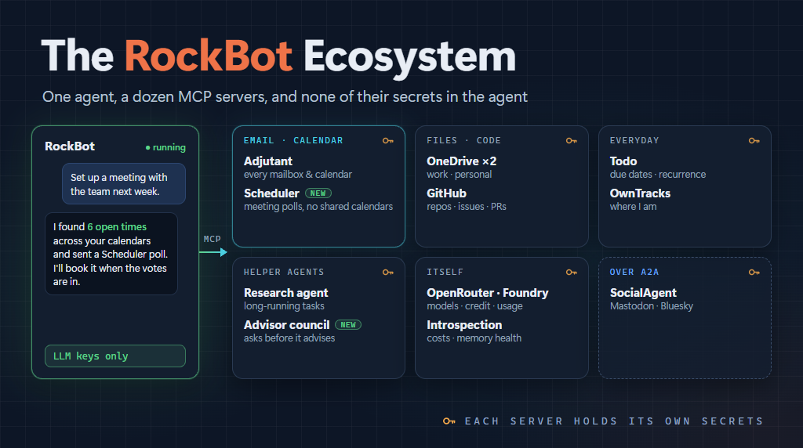

We just added a "RockBot ecosystem" section to the [RockBot readme](https://github.com/MarimerLLC/rockbot), listing the related projects that work alongside the agent. Putting that list together made me realize that my [RockBot Band](/2026/03/03/The-RockBot-Band) post from March is pretty out of date.

Some of the projects have been renamed, some are new, and quite a lot has changed in how I actually _use_ RockBot day to day.

So I want to walk through how my RockBot is configured right now. I'm talking about my actual running instance this time, rather than the framework, and the MCP servers that let it help me manage email, calendar, meetings, files, GitHub, and a few other things.

tl;dr - an agent is only as useful as what it can reach. RockBot itself mostly thinks and remembers. Everything it _does_ goes through MCP servers, each running in its own container and each holding only the secrets it needs.

## What RockBot Can Reach

Here's the list of MCP servers my RockBot agent is connected to as of today:

1. Adjutant - email, calendar, and contacts across all my accounts
1. Scheduler - finding meeting times with other people
1. Two OneDrive servers - one for my Marimer work files, one for personal
1. GitHub - repos, issues, PRs, file contents
1. Todo - a persistent to-do list with due dates and recurrence
1. OwnTracks - where I am (more on this later)
1. Research agent - deeper multi-source research, as an MCP server
1. Advisor council - several advisor personas that deliberate on a decision
1. OpenRouter, Azure Foundry, and Introspection - so the agent can see its own costs and usage

Plus SocialAgent, which RockBot talks to over A2A rather than MCP, to keep an eye on my Mastodon and Bluesky accounts.

That's a lot of moving parts. But each one is a small, focused service, and that is very much on purpose.

## Email, Calendar, and Contacts

The heart of the whole thing is [Adjutant](https://github.com/MarimerLLC/adjutant).

If you've followed along, you might remember this as calendar-mcp. It got renamed (and hit 2.0) because it had grown well beyond calendars - I wrote about that, and everything it can connect to, in [What Adjutant Can Connect To](/2026/11/09/Adjutant-Back-End-Sources). Adjutant is an MCP server that gives an agent email, calendar, and contacts across multiple accounts: Microsoft 365, Outlook.com, Google Workspace, IMAP/SMTP, CalDAV/CardDAV, and read-only ICS feeds.

The "multiple accounts" part is the whole point.

Like a lot of consultants, my life isn't in _one_ mailbox or _one_ calendar. There's my Marimer work account, client accounts, personal accounts, family calendars. Any assistant that only sees one of those is going to tell me I'm free when I'm absolutely not. Adjutant lets RockBot see all of them at once, so "am I free Tuesday afternoon?" gets a real answer.

Each account also has its own permissions. You can let an agent read one mailbox but never send from it, or work with a calendar but never touch the email on that account. I think that matters a lot as we hand more of our lives to these agents. Least privilege applies to "which mailbox" too, not just to which process.

One detail I'm happy with is attachments. Passing file contents through an LLM as base64 is a terrible waste of context, and the models aren't great at it anyway. So RockBot's MCP bridge handles attachments itself. Files live on a shared volume, and the model just refers to them by path. Small files get inlined to Adjutant, large ones get uploaded out of band, and incoming attachments land on the shared volume where the agent (or a Python script it runs) can work with them. The bytes never go through the model.

## Scheduling Meetings

[Scheduler](https://github.com/MarimerLLC/scheduler) is one of the newest pieces.

Scheduling a meeting with people outside your own organization is still a mess. The usual answer is either a lot of email back and forth, or some tool that wants to read everyone's calendar. Most people (rightly) won't share their calendar with a random service, and most companies won't allow it anyway.

Scheduler never reads anyone's calendar.

The organizer (or their agent) proposes a handful of times that already work for them. Everyone invited votes on each time - preferred, yes, if necessary, or no. They can vote from their own MCP-capable agent (Claude, Copilot, RockBot, whatever), or just from a web page linked in the invitation email. Each person's own agent checks their own calendar. The server only ever learns the votes.

This is where Adjutant and Scheduler really work together. When I ask RockBot to set up a meeting:

1. RockBot uses Adjutant to find times that are open across all my calendars
1. It proposes those times through Scheduler
1. People vote
1. Once a time is picked, RockBot creates the real meeting in my calendar via Adjutant, and tells Scheduler it is done

And it works the other way around too. When someone invites _me_ through Scheduler, RockBot can find the invitation email with Adjutant, check each proposed time against my calendars, and vote for me.

> Neither one needs the other. Scheduler works with any calendar MCP server, and people without an agent at all can just click the link in the email. But together they cover the whole loop.

A couple of newer MCP features come into play here too. Scheduler can ask questions in the middle of a tool call (like "you didn't give me a time zone"), and RockBot's bridge hands those questions back to the agent, which can answer from what it knows or ask me, and then resume the call. And each Scheduler event is an MCP resource RockBot can watch, so it finds out when everyone has voted without having to poll.

RockBot runs headless, so it connects to Scheduler with a personal access token rather than an interactive OAuth sign-in.

I've scheduled a number of meetings this way now, and it saves me a lot of time and effort. I don't have to manually look through all my calendars to find open times from work, family, etc. because Rockbot does that via Adjutant. And the login process for using Scheduler (via the web) for everyone else is _so_ much simpler than a lot of other tools, because I'm not trying to sell anything or collect their info - I just want them to login (via oauth) and vote. Or use their own agents to do the voting.

## Files and Code

For files I'm using a community [OneDrive MCP server](https://github.com/MrFixit96/onedrive-mcp-server), running as two separate instances - one signed into my Marimer account, one into my personal account. Two instances means two completely separate sets of credentials, and neither server knows the other exists.

I did add a guard in the RockBot MCP bridge for this one. When RockBot downloads a file, the bridge only allows the target directory to be under the shared volume. The model doesn't get to decide to write files just anywhere.

For GitHub I use my own [mcp-github](https://github.com/MarimerLLC/mcp-github) server, which exposes the GitHub REST API as MCP tools. The GitHub App credentials live only inside that container. RockBot can read repos, work with issues and PRs, and pull file contents (which come back through the same attachment mechanism, so a big file doesn't blow up the context window).

## Everything Else

The rest of the list is smaller, but each one earns its place.

The todo server is just a persistent to-do list with due dates and recurrence. Not glamorous. Really useful.

OwnTracks is newer. I run an [OwnTracks](https://owntracks.org/) recorder in the cluster, and an MCP server in front of it, so RockBot knows roughly where I am. That helps with things like time zones when I travel, and whether "tomorrow morning" means home or a hotel. I went into the details in [RockBot Can Know Where You Are (If You Want It To)](/2026/11/01/RockBot-Location-Awareness).

Right now I'm just having Rockbot use my location data when I ask, but in the future I anticipate being able to use geo-fencing and other spatial capabilities to make Rockbot even more useful and proactive.

The research agent and advisor council are both RockBot agents in their own right, but they are exposed to my main agent as MCP servers, each with one tool. They can take a while, so they run as long-running MCP tasks - RockBot kicks off the work, keeps chatting with me, and picks up the result when it is ready. The advisor council in particular tends to need more context ("how much risk are you willing to take here?"), so it uses the same question hand-back as Scheduler.

And then OpenRouter, Azure Foundry, and an introspection server let RockBot look at itself: what models cost, how much credit is left, how its own memory is doing. Which is a little weird when you think about it too hard, but it is very handy for keeping an eye on spending.

## Least Privilege All the Way Down

OK, so why all these separate services instead of one big agent with a bunch of plugins?

Because of secrets.

One of the core ideas behind [RockBot](/2026/02/18/Introducing-RockBot) is that the agent shouldn't have access to any secrets other than its LLM keys. Everything else - the Microsoft and Google OAuth tokens, the GitHub App key, the OneDrive tokens, the Scheduler access token - lives in the MCP server that needs it, in its own container. Adjutant, Scheduler, and OwnTracks even get their own Kubernetes namespaces.

If the agent gets confused, or gets prompt-injected by some email it is reading (and it _will_ read hostile email, that's what email is these days), it can only do what the tools allow. It can't go grab a token and use it some other way, because it never had the token.

This is the same thinking we've been applying to n-tier apps for decades. You don't put database credentials on the client PC. You put them on the app server. MCP servers are just the app servers for agents.

> This is also why, when I looked at [whether RockBot needs UTCP](/2026/11/08/Does-RockBot-Need-UTCP), I came down on the side of keeping a trusted server in the middle rather than having the agent call APIs directly.

> All of this runs on my home Kubernetes cluster, with Rancher Fleet deploying from git, and Tailscale for the few things that need to be reachable from outside. That's a whole other blog post.

There's a nice side effect too. Because these are just MCP servers, they aren't RockBot-only. The same Adjutant, Scheduler, OneDrive, and todo servers are registered in my [MCP Aggregator](/2026/02/15/MCP-Aggregator), so Claude Code, Claude Desktop, and Copilot can use them from any of my PCs. RockBot connects to them directly inside the cluster, my other tools go through the aggregator. Build the service once, use it from whatever agent I happen to be in.

## Summary

When I wrote the RockBot Band post in March, a lot of this didn't exist yet. Adjutant was still calendar-mcp, and Scheduler, OwnTracks, and the research and advisor MCP servers weren't there at all. Today RockBot can read and triage my email, see what's on all my calendars, set up meetings with people who don't share my calendar (or my employer), find files in OneDrive, and poke at GitHub. All without ever holding a credential other than its LLM keys.

At the start of this journey I had ideas about a useful agent, but honestly it wasn't something I relied on. As these features and capabilities have expanded over time, I find that I rely on my personal agent more and more. Especially for managing my calendars and schedule, as well as finding lost emails and files.

If you want to dig in, the [RockBot readme](https://github.com/MarimerLLC/rockbot) now has the whole ecosystem list, and there's a [Discord server](https://discord.gg/eQjxWG6KYN) if you want to chat about it.

_This post was authored with the assistance of AI._
