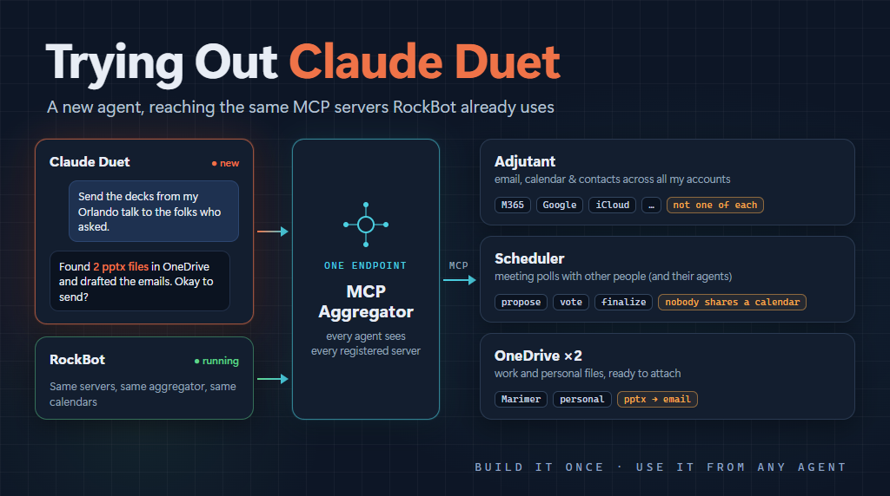

I've started using [Claude Duet](https://techcrunch.com/2026/10/22/claude-duet-app-is-anthropics-bet-on-agents/), Anthropic's new proactive assistant. It checks email and calendars, drafts replies, and generally tries to be the kind of personal agent I've been building with [RockBot](/2026/11/12/The-RockBot-Ecosystem) all year.

So far Duet seems pretty good. Honestly, it is very competitive with what I get out of using RockBot.

But a lot of the reason Duet is so useful for _me_ has nothing to do with Duet itself. It is because Duet can reach [Adjutant](https://github.com/MarimerLLC/adjutant) and [Scheduler](https://github.com/MarimerLLC/scheduler) through my [MCP Aggregator](https://github.com/MarimerLLC/mcp-aggregator).

## One of Each Isn't Enough

Out of the box, Duet connects to one Google account and one Microsoft account.

That's fine for a lot of people. It doesn't match my reality.

As I've discussed in previous posts, my life isn't in _one_ mailbox or _one_ calendar. There's my Marimer work account, client accounts, personal accounts, family calendars, and they are spread across several providers. An assistant that only sees one Google and one Microsoft account is going to tell me I'm free when I'm absolutely not.

This is exactly the problem Adjutant exists to solve. It sits in front of all my accounts and exposes one set of MCP tools for email, calendar, and contacts. I wrote about everything it can talk to in [What Adjutant Can Connect To](/2026/11/09/Adjutant-Back-End-Sources).

And Adjutant is already registered in my MCP Aggregator, which is a remote MCP server, so Duet can use it like any other connector. No changes to Adjutant, no changes to the aggregator. Duet just showed up and started using the same services RockBot and Claude Code have been using for months.

That's really the payoff of building these as standalone MCP servers rather than as RockBot plugins. Build the service once, use it from whatever agent I happen to be in. I said that in my last post, but it is a lot more satisfying to see it actually happen with an agent I didn't write.

## Scheduling With Other People

The same goes for Scheduler.

Scheduler never reads anyone's calendar. The organizer (or their agent) proposes some times that already work for them, and everyone invited votes on each time. Each person's own agent checks their own calendar, and the server only ever learns the votes.

So when I ask Duet to set up a meeting, it uses Adjutant to find times that are open across _all_ my calendars, proposes those through Scheduler, and once people vote it can create the real meeting in the right calendar via Adjutant.

What I find kind of fun is that this means Duet is effectively collaborating with RockBot, and with other people (and maybe their agents), to manage my schedule. Neither agent owns the process. Scheduler holds the state, Adjutant holds the calendars, and whichever agent I happen to be talking to can pick up where the other left off.

## Attachments From OneDrive

The other thing that has been really useful is OneDrive.

I'm not entirely sure if Duet is directly accessing my OneDrive through its own Microsoft connector, or if it is using the OneDrive MCP servers I have in the aggregator. I _suspect_ it is some of each, since the native connector can only see one Microsoft account and I have both a Marimer and a personal OneDrive. Either way, the fact that it can reach my OneDrive accounts has been very handy for emailing attachments to people.

Just today I needed to send a couple pptx files to people from one of my talks at AI Enterprise Architecture Live last week in Orlando. Duet was able to find the files, draft the emails, and send them on my behalf.

That's something I would have had RockBot do if I wasn't testing Duet.

For me, RockBot is better for sending emails because it is _slightly_ less cautious. 

Duet asked if I wanted to have it reply to emails, I said yes, it drafted the email and asked me to approve, then it asked me for permission to send.

RockBot would have asked if I wanted to reply to emails, I say yes, it drafts the reply and asks for approval - then sends it without that final permission check. After all, I already said yes.

Not a big difference; either way the emails get drafted, approved, and sent.

## So Far, So Good

I've only been using Duet for a short time, so I'm not ready to draw any big conclusions. It is a research preview, and I'm sure it will change a lot.

What I _can_ say is that the value I'm getting from Duet comes in large part from the MCP servers it can reach. Which is the same lesson I keep learning with RockBot: an agent is only as useful as what it can reach.

The good news is that if you build those services as standalone MCP servers, every new agent that comes along gets to benefit from them. Duet just happens to be the newest one in my life.

_This post was authored with the assistance of AI._
